# 基于图像的照明（IBL）
IBL是一种通过环境贴图（Spherical Map，Cube Map）来保存某个物体的环境光信息，可以看成是无限远的光照。那么给了IBL要怎么计算着色点的着色呢，自然的我们想到需要解渲染方程。
和阴影相似，这次我们把渲染方程的Lighting项单独拆分出来，这次我们先不考虑可见性V

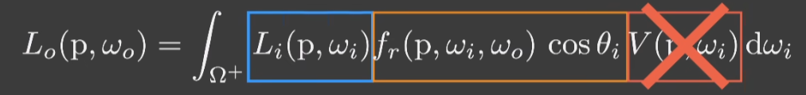

对于渲染方程，我们之前学过用蒙特卡洛的方法来积分求解，但蒙特卡洛需要大量采样才能得到期望的值，对于实时渲染来说，要对大量采样的着色点都求解渲染方程是不现实的，因此，如何在保证质量的情况下，降低求解渲染方程的复杂度，对其近似求解，便是我们要处理的问题。

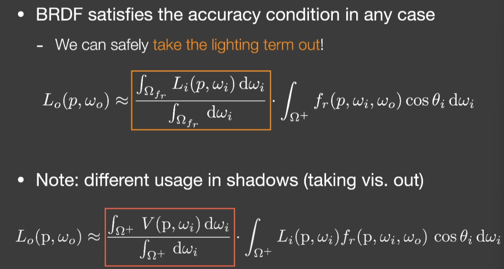

## Split Sum分离求和法
split sum通常是把一个大的和式近似的拆为多个合式计算，从而降低计算的复杂度
### Prefilter
把lighting项拆出来，其实就相当于给IBL的图加一个filter，也就是模糊处理。这一步通常是在渲染之前预先计算好的，也就是Prefilter。类似mipmap，我们还可以先生成一系列多次滤波核大小不同的图，在使用的时候再进行查询，还可以在相邻图之间进行三线性插值。

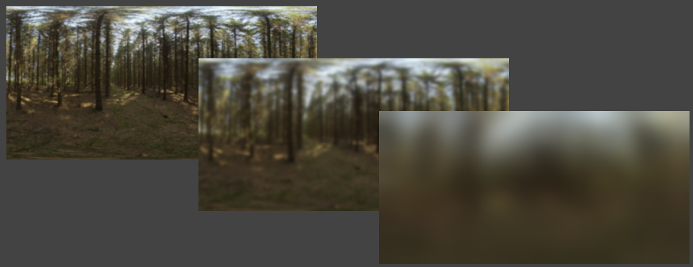

那我们为什么要做prefilter操作呢？看下面这个图，我们从某个方向看向着色点，它的BRDF应该是一个lobe，我们再根据lobe的范围进行采样，最后平均就可以得到着色点的值。
prefilter的操作就相当于，我们先对light做一个filter，然后只在一个镜面反射的方向上去查，这样查的只是一个值，但是因为我们对环境光照已经fliter了，所以查这一个值就相当于查周围的一片值了。

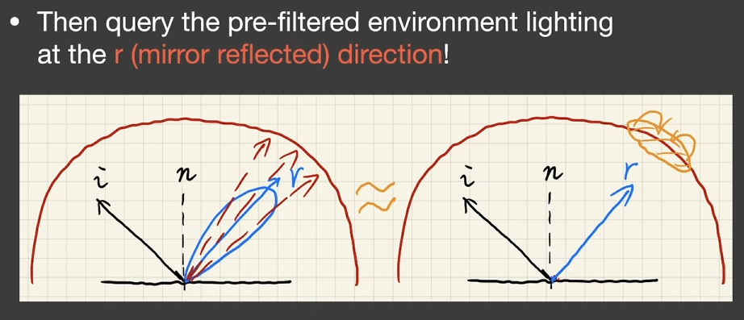

### 预计算Precomputer
我们目前解决light的问题，下一步就是怎么求BRDF的积分，我们通常也是通过预计算来解决。
但是BRDF的关键参数包括： **RGB**、**roughness**、**入射角度**​等等，所以BRDF是一个五维函数。要对这么多参数的积分进行预计算，我们目前是无法实现的。

为了可以预计算，我们可以通过一系列办法把BRDF降维。我们知道Microflact的BRDF的如下：

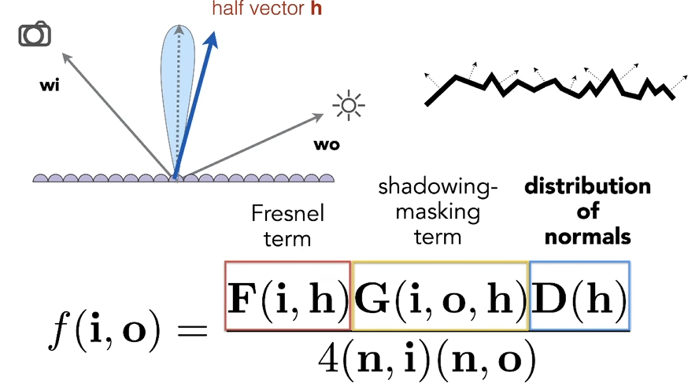

- F($w_{i}$,h): 菲涅尔方程（Fresnel Equation）,描述不同的表面角下表面所反射的光线所占的比率。
- G($w_{i}$,$w_{o}$,h): 几何遮蔽函数（Geometry Function）,描述微平面自阴影的属性，即m = h的未被遮蔽的表面点的百分比。
- D(h): 法线分布函数 （Normal Distribution Function）,描述微平面法线分布的概率，即正确朝向的法线的概率。
具体到现在的情况来说

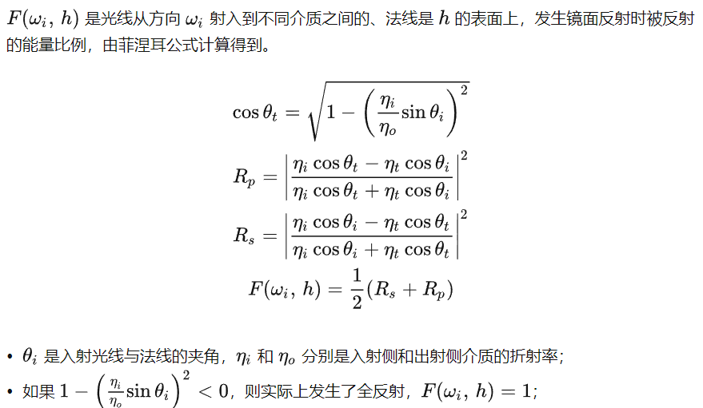

通常我们可以近似为：

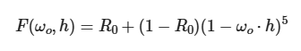

对于法线分步函数D使用Beckman的模型描述：

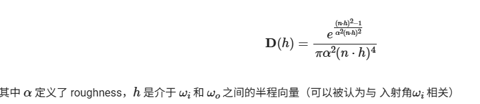

这样我们就把BRDF的五维降到了三维
带入到渲染方程里进行一系列变换：

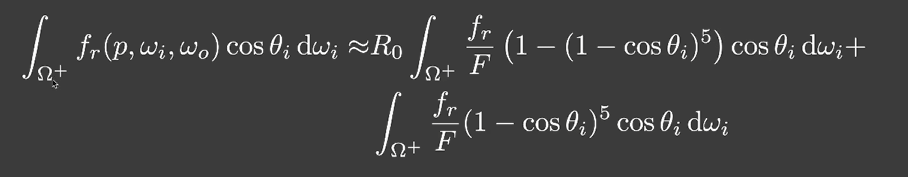

我们就把基础反射率拆出来了，再预计算只需要考虑roughness和入射角度了，也就变成查询二维的LUT表了。

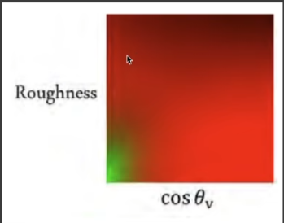

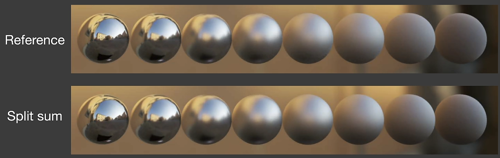

但是如果要考虑可见性，即计算环境光照的阴影是相当困难的
1，环境光照计算阴影非常困难，因为要计算无数光源都要生成的shadowmap，也就是多光源问题。
2，采样多少问题
因此工业界的一般解决方案是选取环境中最亮的那个光源（例如太阳）或前几个光源生成阴影图，然后由此生成阴影
# 球谐函数 Spherical Harmonics
## 基函数
一个函数可以用一系列函数和系数相乘后的线性组合来描述，这一系列组合的函数就是基函数。傅里叶级数展开的一系列函数就可以看成一组基函数。

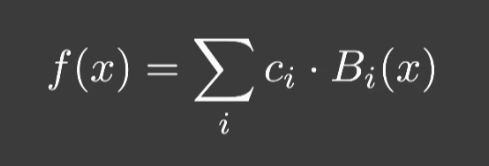

## 球谐函数（SH）
一系列定义在球面上的二维基函数。
不同阶的SH基函数如下，颜色表示它的值，蓝色偏大，适合描述低频的光照。

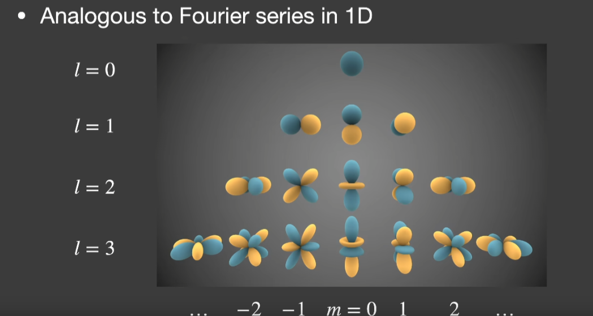

第n阶有2l+1的基函数，前n阶的和为n²
对于一个二维球面函数，如果想要展开成一系列 SH基函数的线性组合，计算每一个基函数前面的系数 （这个过程可以被称为投影，即将一个二维球面函数投影到每一个SH基函数上）的公式如下：

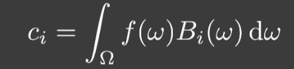

知道了系数，我们就可以恢复原来的函数了，一般我们用前4阶的基函数就能很好的恢复出原来的函数。

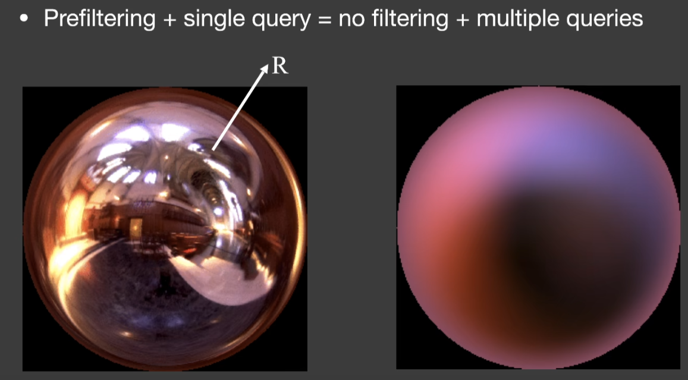

## 球谐函数的性质
- 正交性（orthonormal）：SH是一组正交基，SH的一个基函数投影到另一个任意函数上的值为0
- 投影运算简单
- 旋转运算简单：任意基函数旋转后可以被同阶基函数的线性组合来描述。（可以打表预计算）
- 卷积运算简单
# Precomputed Radiance Transfer（PRT）
而想要求在有阴影情况下的环境光照，我们可以先把环境光照的渲染方程可以看成三个部分，即lighting项，visibility项和BRDF项。

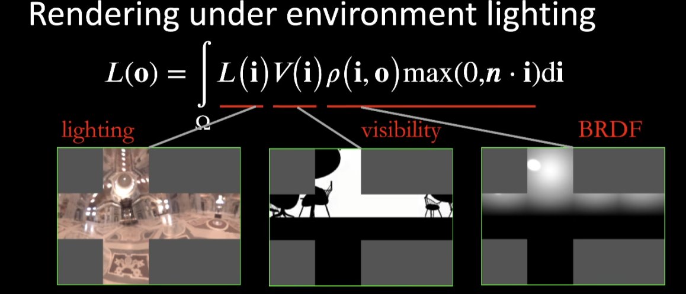

要计算这个积分，我们对每一个着色点都要计算许多次，这会带来很大的性能消耗。
PRT的核心思想是**假设渲染方程只有光照会变化**，其他不变。在基函数的思想上，只需要把其他部分预计算。即将方程的被积函数拆成lighting和light transport（光线传输）两部分，预计算他们的纹理图像，再把他们从时域转换到频域，最终在着色时绘制方程中的定积分计算转换成向量的点积。

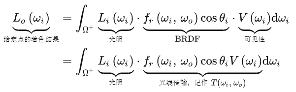

- 对于光照项Lighting，我们可以把lighting拆成一系列基函数，也就是SH基函数来近似表示。**只需预先存储若干个 SH 系数而不必存储一整张环境贴图。**
- 对于光线传输项 Lighting transport，在场景只有光照情况会发生改变时，可以被视为一个二维球面函数，也可以用 SH基函数 的线性组合来近似表示。**只需预先存储若干个 SH 系数（diffuse情况下）或者矩阵（glossy情况下），预计算好的传输可以在实时渲染中以极低代价实现自阴影、互反射的效果。**

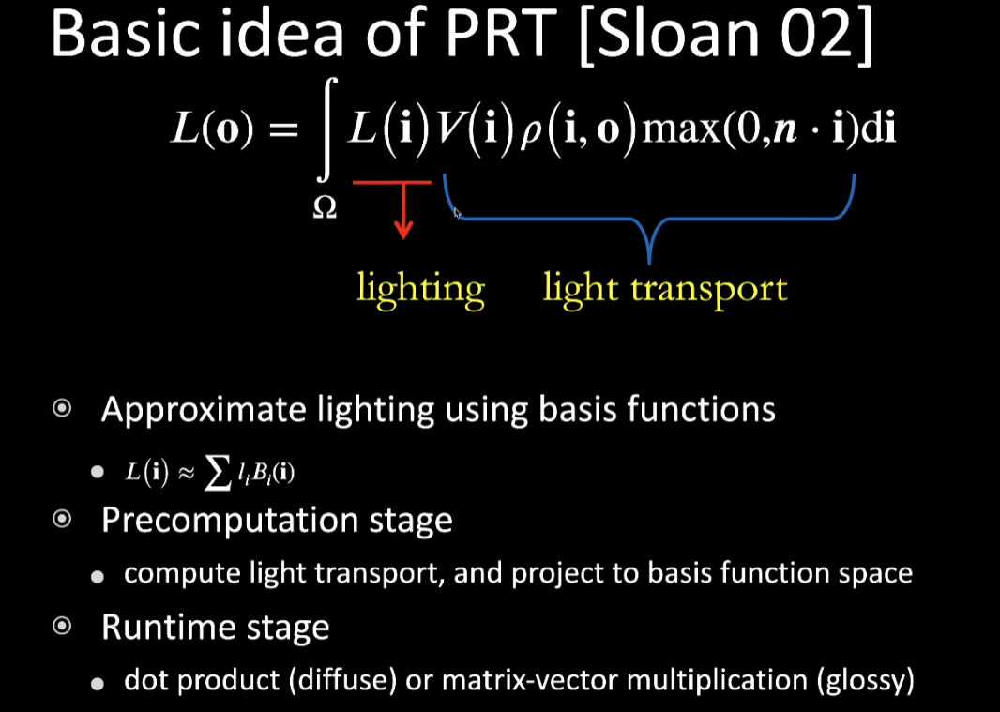

## Diffuse Case
在diffuse的情况下，我们知道漫反射的BRDF可以看成是一个常数ρ，把ρ拆分到积分外面。

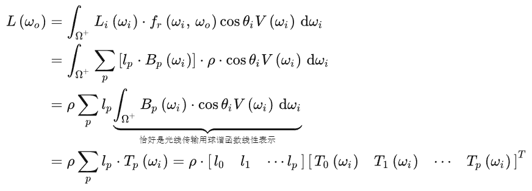

最终的渲染方程我们可以得到近似的表示：

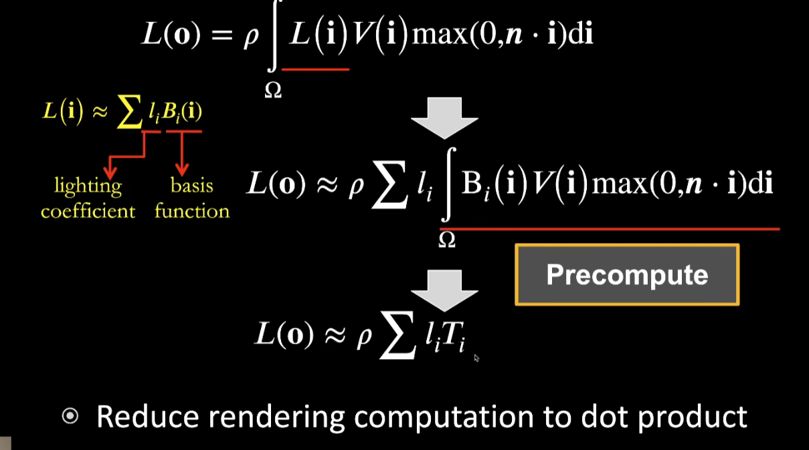

这样，渲染方程就近似简化为了对一个**点积**进行求和，其中$l_{i}$和 $T_{i}$可以被预计算打表，只要对于每一个着色点提前对球面函数求在每一个基函数上的投影以得到每一个基函数的系数即可。

代价在于，除了光照之外，**场景是不能变化的**。
对于光照，可以用球谐旋转不变性解决，即任意基函数旋转后可以被同阶基函数的线性组合来描述。
如果光源旋转，我们可以描述为光源不动，旋转任意表示球谐的基函数，而任意基函数旋转后可以被同阶基函数的线性组合来描述。我们就可以得到旋转整个environment map之后，用一张表来存储光照信息发生旋转时的情况。

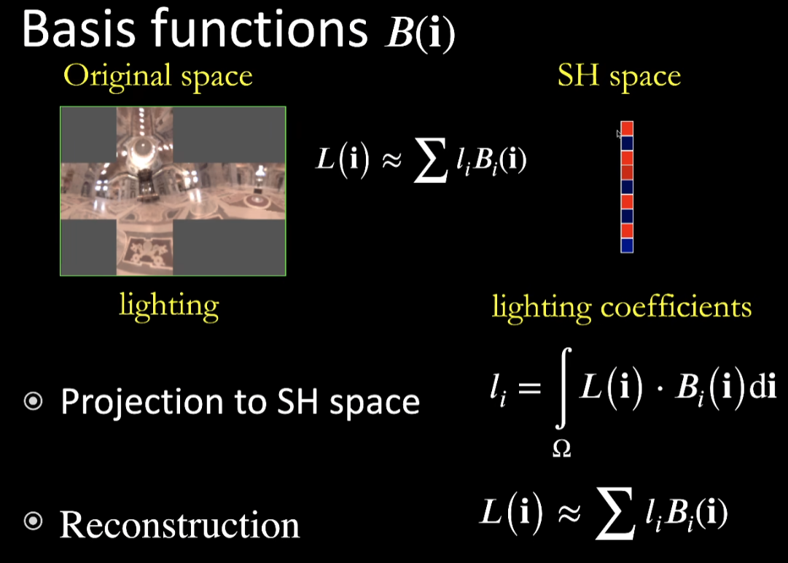

对于diffuse的情况看起来是n²的算法，但其实是n，因为根据正交性，x轴投影到x轴上才能得到1。即只有pq相同时，右面的积分才是1，否则为0.

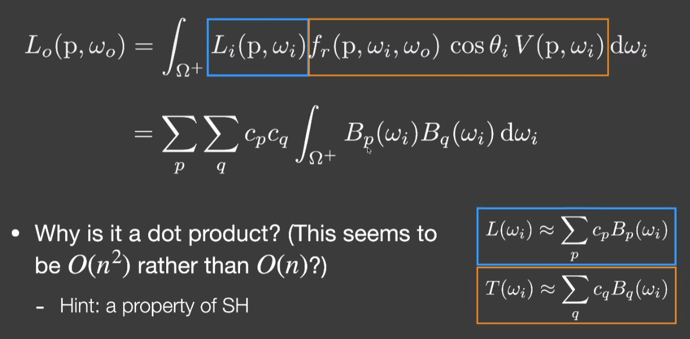

## Glossy Case
glossy与diffuse物体的区别主要在BRDF上，glossy的BRDF不在是一个常数，而是与光线入射方向$w_{i}$和视角方向$w_{o}$有关。其中$w_{i}$在之前一直看成一个可变量处理，因此不影响复杂度。对于$w_{o}$是一个新增的变量，我们相当与在原来的PRT上多加了一个维度。
我们可以直观的理解为：diffuse的情况下，无论怎么移动相机，着色结果都不会发生变化，因此$T_{i}$我们只需要打一张一维的表就行了。而glossy的情况下，相机的移动会对着色产生影响，我们就需要尽可能的对每一个相机位置进行打表。
因为$T_{i}(o)$是一个二维的球面函数，可以用基函数的线性组合来表示。

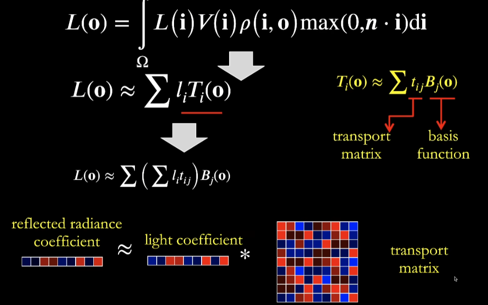

我们就可以把渲染方程简化为对一个向量和矩阵的乘积求和。

相较于diffuse的情况，glossy的代价大幅提升，我们需要额外存储一张二维的表。
## PRT的优点
- 对于任何光线路径，都可以用预计算的思想
- 预计算在实时渲染产生的效果相当好
## PRT的缺点
- 要求场景不能发生变化
- 因为球谐函数适合表示低频的信息，因此PRT对低频的信息效果比较好，高频的比较差，因为高频的需要高阶的球谐基函数来近似
- 预计算需要占用比较大的空间开销

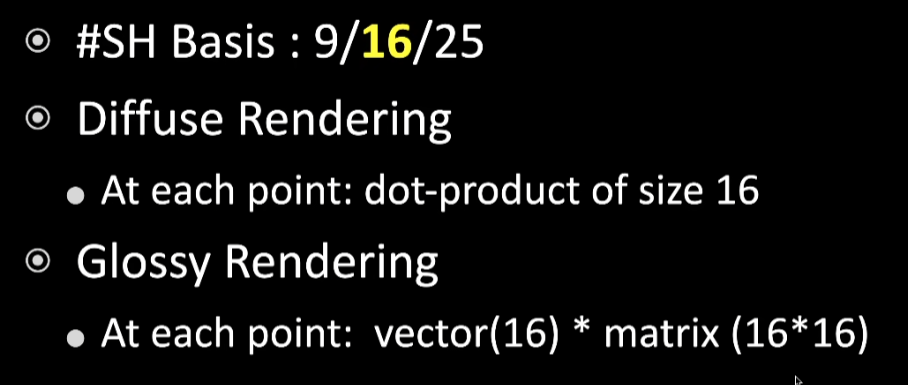

[四 实时环境光照 Real-Time Environment Mapping - ziao德的个人网站](https://cxd-gilneas.github.io/BLOG/ComputerGraphics/GAMES202/4_%E5%AE%9E%E6%97%B6%E7%8E%AF%E5%A2%83%E5%85%89%E7%85%A7/#2-shadow-from-environment-lighting)
[图形学渲染基础(7) 实时环境光照(Real-time Environment Mapping) 简介 全局光照（Glo - 掘金](https://juejin.cn/post/7026291302547324964)
