## Shadow Mapping
这部分games101提过了，大概流程就是分两个pass
第一次pass：用一张贴图记录从光源发出的射线对场景投射并形成z-buffer，拿到shadow map，保存离光源最近的像素的深度。
第二次pass：从相机位置出发渲染场景，比较当前像素的深度d和ShadowMap中的深度s，如果d > s则表明在阴影内，如果d <= s则表明在阴影外   
### 缺陷：
#### 自遮挡
不是由采样造成的（摩尔纹），由于数值精度产生。


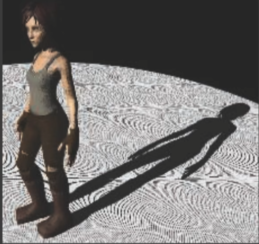


由于shadowmap的分辨率有限，shadowmap的一个像素对应场景中的一块区域，但是计算的仅是这片区域中心的位置。比如p1和p2在shadowmap的深度是相同的s，但是在第二次pass对他们比较后，p1大于s在阴影里，p2不在，这就产生了自遮挡。


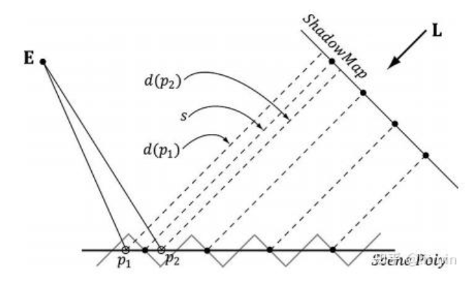

显然，当光源与地面越平行问题越大。

目前工业界用bias解决，即给shadowmap的深度值加一个偏移，偏移后，发现两个点的深度都比s小了,自然不会发生自遮挡了。bias要选择合适的值，否则就会发生peter-panning：影子在接触位置分离。
**避免使用单薄的几何体**；只要几何体厚度大于Bias，影子边界便会产生在几何体内部，从而不易看见影子与几何体的分离现象。

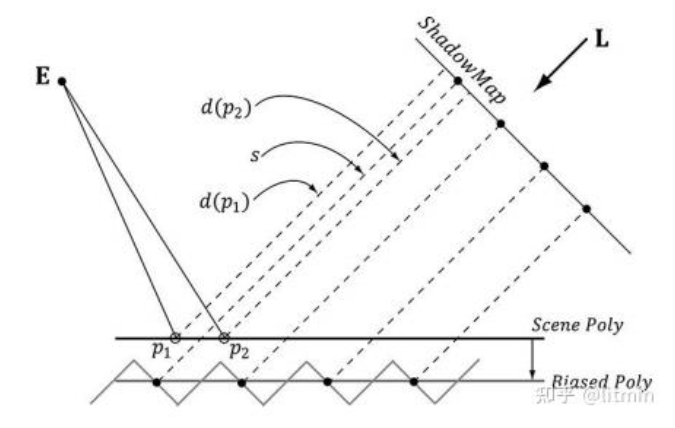


可以通过记录最小和次小的深度，使用两个深度的中间值来解决。但是要求材质必须是watertight的，虽然算法的时间复杂度不高，但是**实时渲染不相信复杂度:)**。所以没有被工业界广泛应用。


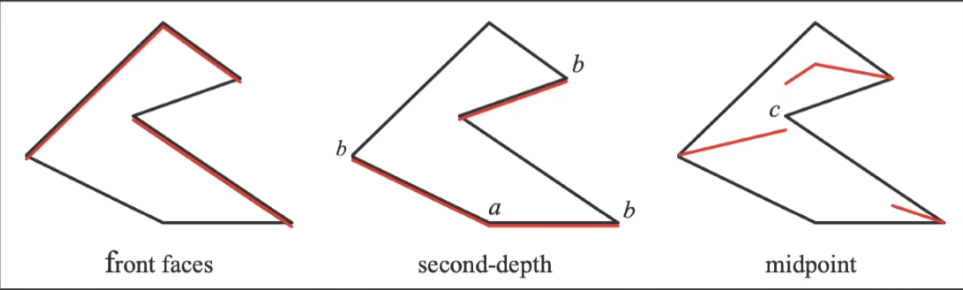


#### 走样
阴影图有分辨率，分辨率低就会产生走样。级联阴影可以解决，后面会具体提到。
### 基础原理


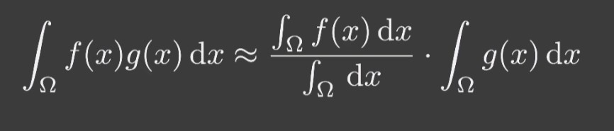


分母为归一化
1，$g(x)$的support（积分率）很小（对应**点光源**和**方向光源**）
2，$g(x)$是smooth的，在积分率的变化不大（对应**不会有光强变化的面光源**，或brdf是smooth的，即**漫反射brdf**）
在这两种情况下可以认为这个等式近似相等。
由此，我们可以把渲染方程的可见性V单独提取出来，作为$f(x)$，而$g(x)$就是普通的shading。这样就能在计算完shading之后再乘上可见性，这就是阴影映射的原理（先计算 shading，然后再将阴影映射纹理采样的结果乘到这个 shading 上）


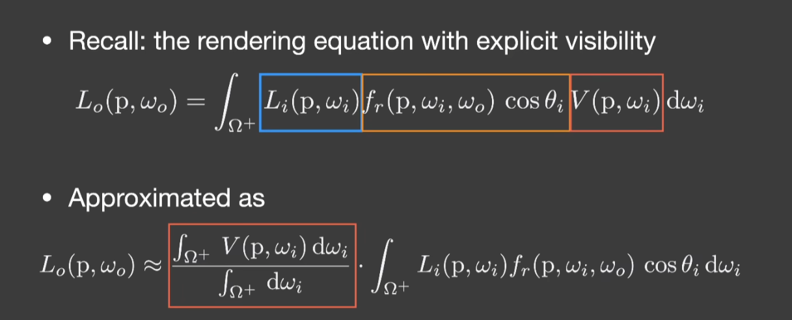


## 百分比渐进软阴影（PCSS）
### 百分比渐进滤波（PCF）
是一种反走样滤波算法，目的是解决ShadowMap的锯齿问题。是对采样点p在shadow map上的深度和周围范围内点的深度进行比较，再把比较完的值加权平均起来，作为p的可见性，这样阴影的数值范围就会在[0，1]之间连续分布，不在是离散的非黑即白。

为了让阴影边缘更加柔和，我们可以用一些较好的分布采样函数。
**均匀圆盘分布采样：** 圆范围内随机取一系列坐标作为采样点；看上去比较杂乱无章，采样效果的 noise 比较严重。
**泊松圆盘分布采样**：圆范围内随机取一系列坐标作为采样点，但是这些坐标需要满足一定约束，坐标与坐标之间至少有一定距离间隔。

**Tips：PCF 不是对最后生成的图像进行滤波，也不是在 Shadow Map 上直接进行滤波，而是对采样的结果进行滤波**

算法如下：
1.计算 Visibility 时，原本对 Shadow Map 的一次坐标采样换成对周围一定范围内若干个坐标进行采样。
2.各个采样结果同样用来与 z′ 做比较，最后取比较结果的平均作为 Visibility。
```
float visibility_PCF(sampler2D shadowMap, vec4 coords) {
  const float bias = 0.005;
  float sum = 0.0;
  // 初始化泊松分布
  poissonDiskSamples(coords.xy);
  // 采样
  for(int i = 0;i<NUM_SAMPLES;++i){
    float depthInShadowmap = unpack(texture2D(shadowMap,coords.xy+disk[i]*0.001).rgba);
    sum += ((depthInShadowmap + bias)< coords.z?0.0:1.0);
  }
  // 返还平均采样结果
  return sum/float(NUM_SAMPLES);
}
```

### Percentage Closer Soft Shadows（PCSS）
在 PCF 的基础上，如果 Filter 取的过大，则某个点的阴影会和过多的点发生加权，导致结果上虽然实现了抗锯齿，但是会使阴影模糊。而这种模糊虽然对硬阴影是不正确的，但却正是软阴影所需要的。因此，可以通过**调整 Filter 的取值**范围来实现不同需求的软阴影，即 PCSS 
可见，如何调整Filter的值就显得非常重要了。
一般来说，Filter越大，阴影的边缘越柔和，越小则越锐利。而现实生活中，遮挡物里阴影越近，阴影就越硬，反之越软。我们就可以根据遮挡物里阴影的距离来调整滤波的大小。


我们知道，面光源照射物体会产生半影，半影的大小就决定了阴影的软硬。当面光源位置固定时，遮挡物与接收投影面的光线可以构成黄色的相似三角形，遮挡物远的半影w大，近的w小。显然，只要根据不同位置动态地修改圆盘半径大小,也就是这个**半影w就可以很好的作为Filter取值参数**了
**$$W_Penumbra =(d_Receiver −d_Blocker )⋅W_Light /d_Blocker$$**
 

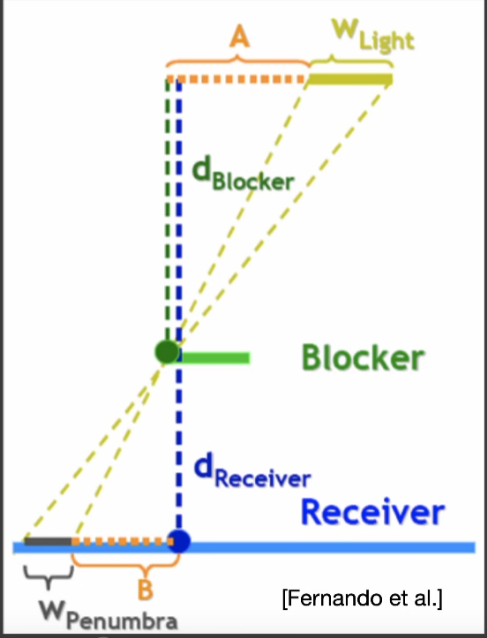


 **Tips：面光源无法生成shadowmap，可以看成由中心点的点光源来解决。**
 总结一下，PCSS的流程如下：
 1，**Blocker Search：** **查找遮挡物的平均深度**。在一定范围内多重采样，每次采样得到的深度若小于$d_Receiver$则认为遇到遮挡物并算入平均遮挡深度的贡献，这样多重采样之后得到的平均遮挡深度就作为$d_Blocker$
 2，**计算半影w的大小:** 使用平均遮挡物深度决定半影大小
 3，**百分比渐进滤波**：用半影大小决定滤波大小，进行PCF

```
float visibility_PCSS(sampler2D shadowMap, vec4 coords){
  poissonDiskSamples(coords.xy);
  // STEP 1: avgblocker depth
  float dBlocker = findBlocker(shadowMap,coords.xy,coords.z);
  // STEP 2: penumbra size
  const float wLight = 0.006;
  float wPenumbra = (coords.z-dBlocker)/dBlocker * wLight;
  // STEP 3: filtering
  const float bias = 0.005;
  float sum = 0.0;
  for(int i = 0;i<PCF_NUM_SAMPLES;++i){
    float depthInShadowmap = unpack(texture2D(shadowMap, coords.xy + disk[i] * wPenumbra).rgba);
    sum += ((depthInShadowmap + bias)< coords.z?0.0:1.0);
  }
  return sum/float(PCF_NUM_SAMPLES);
}
```
### PCSS的问题
PCSS的耗时非常长，尤其是第一步与第三步都要对区域范围内物体多重采样。工业界一般通过在区域内进行稀疏的随机采样来近似解决。但同时会引入一定的噪声。
### Penumbra Mask
我们的软阴影只发生在半影区，实际上很多全阴影区域和全光照区域是不需要软阴影效果的。
- 可以先对每个 pixel 进行 blocker search，blocker search 的样本也同时用于与 pixel 在 shadow map space 的深度作比较；如果比较结果为部分样本被遮蔽而另一部分样本不被遮蔽，则意味着该 pixel 位于半影区，这时候才进行后续的 PCF 采样。
- 先用硬阴影技术生成 screen space shadow mask texture，然后对这张 shadow mask texture 进行边缘检测，将处于边缘的 pixels 标记出来；之后在进行一个 full-screen shader 来对有标记的 pixels 进行 PCF 计算。
## 方差软阴影映射（VSSM）
### Variance Soft Shadow Mapping（VSSM）
PCSS 的第3步，**本质上是通过卷积算法算区域深度的平均值**，然后跟当前深度进行比较，根据这个比较值进行阴影的淡化。这个过程可以理解为找到当前深度在该区域内的**百分比位置**，直接用这个百分比来淡化阴影。
vsmm就基于这种思想：不再遍历所有点，而是利用他们深度值的正态分布来快速得到他们的百分比位置。而为了得到正态分布，我们就需要得到所有深度值的**方差**和**平均值**。
可以通过该正态分布的**累积分布函数 CDF**，快速的算出该范围内有多少比例的数大于某个值
具体操作如下：
- 快速求解在shadowmap上给定一个区域记录的平均深度（SAT算法）与方差
- 计算累积分布函数CDF
- 根据CDF加速PCF算法
#### 计算平均值与方差
为了快速查询得到某块方形范围再求均值,我们会想到之前学过的mipmap，下面就介绍一下方法
- **硬件Mipmap**：基于GPU硬件实现范围查询，通过双线性，三线性插值得到的结果是**近似**的均值
- **SAT算法**：基于前缀和，利用一张额外的表来记录前缀和，是一种用空间换时间的算法。当shadowmap更新时，需要重新进行二维前缀和计算。
一维


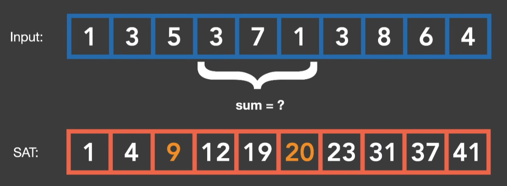


二维
查询某段方形的范围，可以通过下图快速查询得到某段范围的总和，除掉范围面积就能得到均值（期望值）


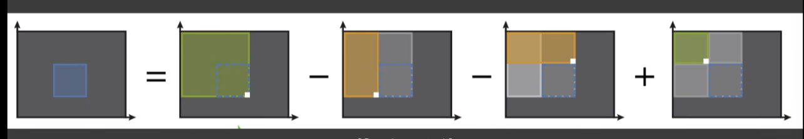


- **Var方差=E（X²）-E²（X）**
要求方差，我们需要另外一张shadowmap，记录深度的平方
#### 计算累计分布函数
有了均值和方差后，我们就能根据切比雪夫不等式确定一个正态分布。可以快速得到t的百分比位置。


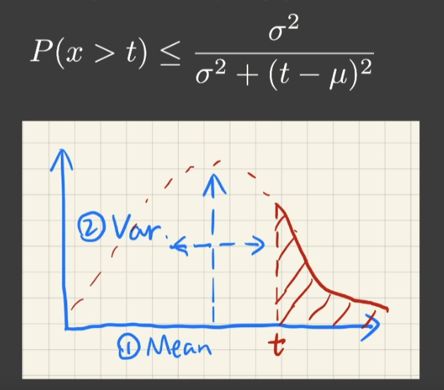


#### 加速Blocker Search
若设 $d_Receiver$ 为7，平均遮挡深度 $z_occ$则为蓝色部分的平均值,也是我们要求的部分。
设该采样范围的面积为 N，无遮挡的面积占有$N_1$，有遮挡的面积则占有 $N_2$=1−$N_1$.。有：

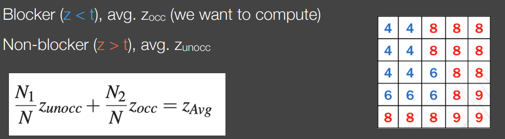


- 平均深度$z_Avg$ 通过 SAT算法直接从整张纹理取得这一块特定区域的平均深度
- 利用切比雪夫不等式我们可以得到$\frac{N_1}{N}$的百分比，$\frac{N_2}{N}$也可以知道。
- 我们大胆假设所有遮挡物的深度$z_unocc$= $d_Receiver$ =t.
#### 加速PCF
PCF多重采样时每次采样得到的遮挡物深度用来与 z′ 做大小比较（小于 z′ 则视为被遮挡，大于 z′ 则视为全亮），最后取比较结果的加权平均作为 Visibility。VSSM则通过切比雪夫不等式直接近似获得该区域比当前深度值 t 小的点占总数的**比例 ​**​，作为Visibilty

### VSSM的缺陷
由于使用了切比雪夫不等式，必须要求区域内的深度值是呈正态分布的。一旦分布不是正态的（例如离散多峰的情况），就会导致利用切比雪夫不等式计算的大小不正确，导致阴影产生**漏光现象 Light Leaking**


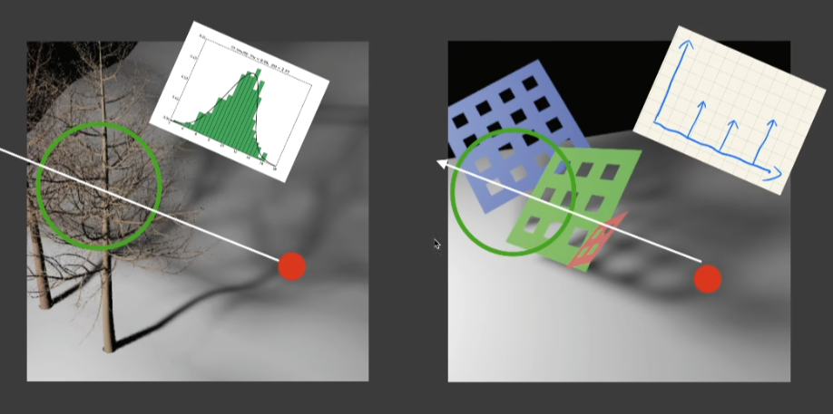


## Moment Shadow Mapping（MSM）
当VSSM描述深度分布不准的时候，通过记录更多阶的矩 (moment)，就可以拟合出更准确的CDF。VSSM 本质便是记录 2 阶的矩来复原 CDF 函数，而 MSM 一般使用4阶的矩就已经足够接近实际的CDF了。
## 距离场软阴影(DFSS)
### 有向距离场（SDF）
对于空间中的任意一点，它都有一个和某个物体表面的最近的一个点的距离（这些距离信息统称为距离场），这个距离可以根据在物体内部或者外部附上方向。


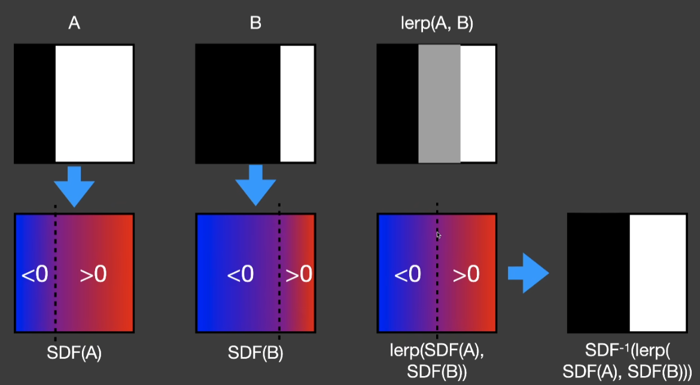


### 光线步进（Ray marching）
通过SDF的思想，SDF定义了一点到物体表面的安全距离，在这个距离为半径的圆内，光线都不会和任何物体相交。


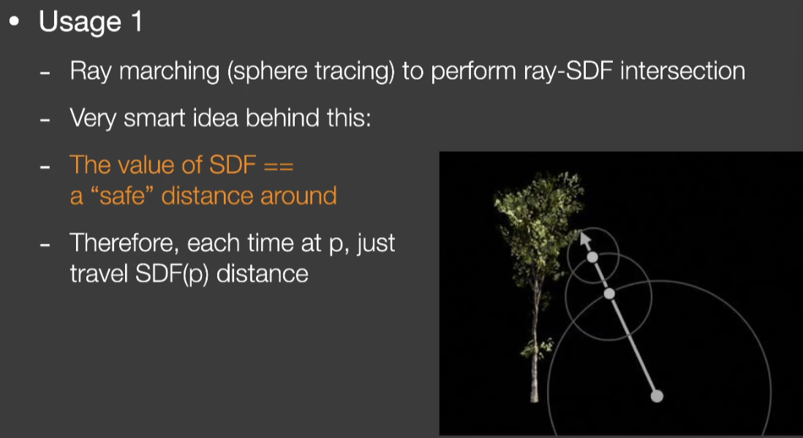


### Distance Field Soft Shadow (DFSS)
SDF还可以获取到一点的安全角度，在这个角度范围内的光线不会被遮挡。如果从某个着色点出发看向光源的安全角度越小，说明这个点被遮挡的程度高，阴影就比较深。这种方法得到的阴影非常快速，效果还不错。


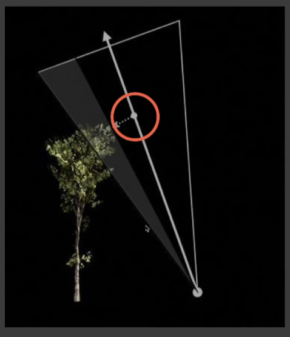


想要计算这个 角度，标准计算方法为取角度大小反三角函数，在图形学中，我们用如下近似来加速计算：


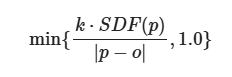


K为缩放系数，其值可以决定阴影的软硬程度，k越大，则计算得到的半影大小会越小（因为角度越大，则表示越不在遮挡范围内），阴影越硬。


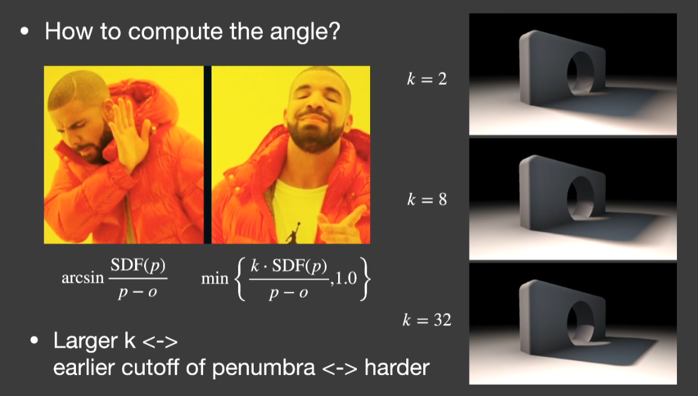

优点：时间比较快，效果比较好
缺点：占用存储比较大，需要大量的预计算

## 级联阴影Cascade Shadow Map(CSM)
阴影贴图的分辨率往往是有限的，在大型场景中阴影贴图的精度往往不够使用。


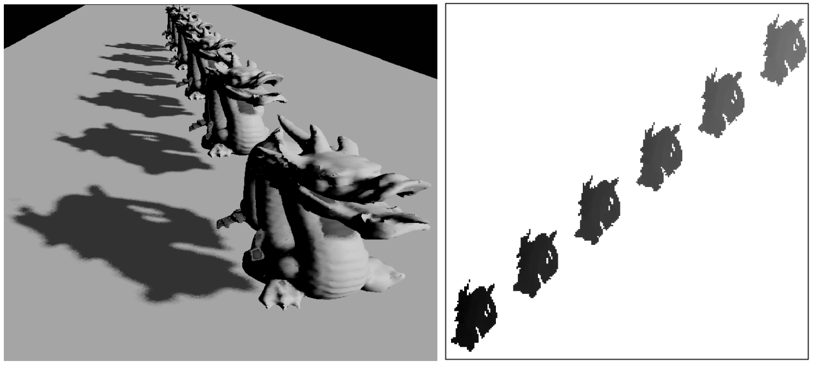


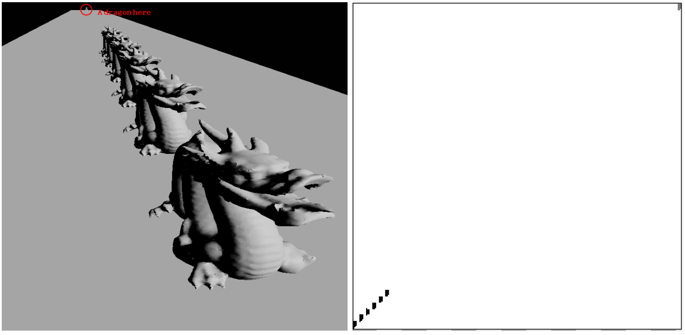


CSM通过**根据对象到观察者的距离提供阴影贴图**来解决这个问题。类似于**LOD**，对主摄像机的视锥体范围进行划分，采用相同分辨率的shadowmap。
我们把蓝色看成传统点光源生成的shadowmap，红色则是CSM生成的。而红色和蓝色方案使用的阴影贴图分辨率是相同的，这样就缩小了 AABB，提高了阴影的精度

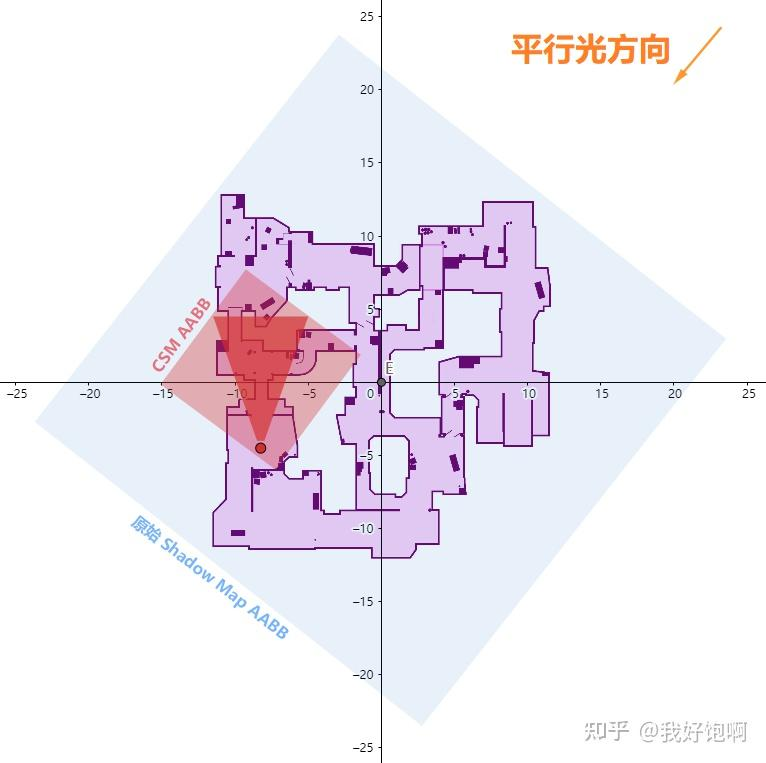


- 切分Camera Frustum，将视锥体划分成若干层，计算投影矩阵
- 计算包围盒，用对应的shadowmap包围分割好的视锥体
- 层级选择，判断着色点位于视锥体的哪一层级上
- 分帧更新，为了降低开销，对于远处的shadowmap降低更新频率。
### Stablize CSM
由于CSM的投影矩阵是随着视锥体变化的，变化产生的计算精度差异会导致阴影抖动。Stablize会将视锥体的变化拆解为平移和旋转来计算，以减少误差。
 

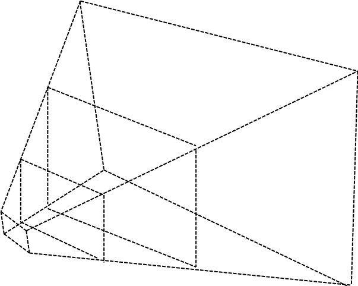


### CSM的缺陷
- 实际中只能解决中距离的阴影，过近的精度不够，过远的会对范围内所有物体绘制阴影导致drawcall增加。
- 无法复用缓存，对应光源与场景都是静态的情况，shadowmap是不会变化的，而CSM的缓存会被浪费。
- 相机移动会看到阴影切换
- 部分sahdowmap无法用到但仍然绘制
## Virtual Shadow Map（VSM）
VSM是虚幻使用的一种阴影方法，通过VirtualTexture构建ShadowMap，同样是为了实现不同距离的区域的精度不同。VSM只是一个分辨率非常高的shadow map，分辨率为16k x 16k，根据camera的距离将shadowmap划分为分成128x128的page。以Clipmap（平行光）或Mipmap（点光和聚光）的方式来组织虚拟贴图。
流程如下：
1. **建立虚拟地址空间**：虚拟分辨率为 **16384 × 16384**，拆成 **128 × 128** 的页；这不代表整张贴图都实际占用显存。
2. **请求需要的页**：分析屏幕深度，确定可见表面需要查询哪些阴影区域，再渲染相应页面。屏幕外的物体仍可能参与投影。
3. **复用缓存**：有效页面沿用上一帧结果；物体或灯光变化导致相关页面失效后，再更新。
4. **查询阴影**：利用页面里的深度判断遮挡。方向光还使用 **Clipmap**，让相机附近保留更高的阴影精度。
总结来说就是**按需生成、分页存储、跨帧复用**的阴影系统，把大贴图变成了很大的地址空间。
- **虚拟页 Virtual Page**:阴影贴图逻辑空间中的一块区域
- **物理页 Physical Page**:显存中真正存放阴影深度的空间
- **页表 Page Table**:记录虚拟页对应哪个物理页
虚拟页 A 可以放在物理槽位 7，虚拟页 B 可以放在物理槽位 2。它们在虚拟贴图中是否相邻，与物理存储位置无关。


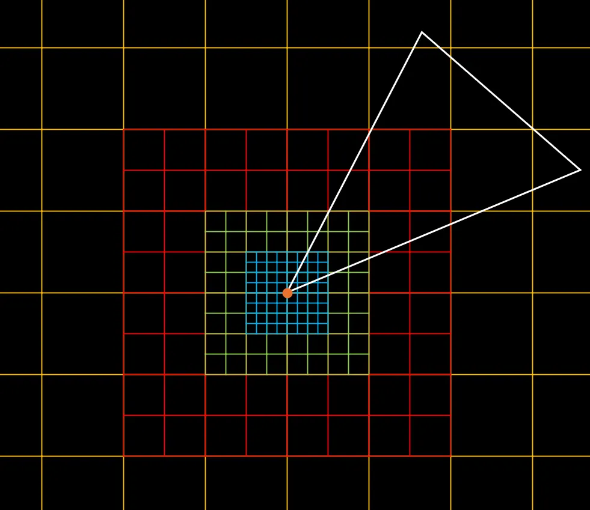


## 逐对象阴影Per-Object Shadow
逐对象阴影一般是拿来做角色的高精度阴影的，这部分我在做终末地的角色渲染里面用到了，所以也提一下。比较适合少量重要对象的局部高质量阴影。
主要流程如下
1. **收紧投影范围**：从光源视角，用物体包围体确定阴影覆盖范围。
2. **记录深度**：渲染这个物体，保存各方向上最近的表面深度。
3. **判断遮挡**：把接收点投影到这张贴图，比较深度；接收点在物体后方，就处于阴影中。
**接收阴影的表面可以在物体包围盒之外**，例如角色的影子落在远处地面上。

这篇文章主要还是作为新人的一个学习笔记，只是记录一下原理，梳理一下相关的方法，用来总结和复习，许多有关方法的具体实现都没详细的深入，大家有不明白的地方可以自行了解。

参考文章与部分图片来源
[Cascaded Shadow Mapping - Personal Page of PixelVoyager](https://chzhangtud.github.io/zh/csm/)
[(2 封私信) Cascade Shadow Map 实现记录 - 知乎](https://zhuanlan.zhihu.com/p/515385379)
[实时阴影技术（1）Shadow Mapping - KillerAery - 博客园](https://www.cnblogs.com/KillerAery/p/15201310.html#cascade-shadow-mapcsm)
[(2 封私信) UE5学习记录-Virtual Shadow Map - 知乎](https://zhuanlan.zhihu.com/p/1973068100296527933)
[虚幻引擎中的虚拟阴影贴图 | 虚幻引擎 5.8 文档 | Epic Developer Community](https://dev.epicgames.com/documentation/unreal-engine/virtual-shadow-maps-in-unreal-engine?lang=zh-CN)
