BRDF的关键参数包括： 入射角、反射角、以及与物体表面的法平面和切平面上的关系，所以BRDF是一个四维函数，主要定义了物体表面的反射情况。
对于diffuse的物体，它的brdf是一个常数。对于glossy，它的brdf是完整的四维。l
## BRDF
### DIffuse BRDF

Diffuse material：光线打到一个点上后均匀分散到各个不同的方向上

Lambert漫反射BRDF：
我们认为一个diffuse材质的radiance是均匀分布的，如果这个点不吸收光，根据能量守恒，光进来多少就反射多少，所以入射光和出射光的radiance是相同的。根据渲染方程，去掉自发光项，我们认为入射光$\omega_{i}$从任何一个方向来，经过漫反射(BRDF是一个常数$f_{r}$)后会被反射到$\omega_{o}$上。在半球上对立体角积分，得到的结果是$\pi$。由此我们得出BRDF等于$\frac{1}{\pi}$。

> ⚠️ 待补图：wps1.jpg

 

Brdf是(0，$\frac{1}{\pi}$)的,在等于$\frac{1}{\pi}$时，是完全不吸收能量的。
我们还可以定义反射率的概念albedo，它可以是单通道的一个数，也可以是三个数RGB，也可以是光谱。它的值在（0，1）之间，实际参与了BRDF的diffuse部分。这样我们就能引入不同颜色的BRDF
### Glossy BRDF
表示物体表面光滑与高光的集中程度，主要影响BRDF的Specular部分

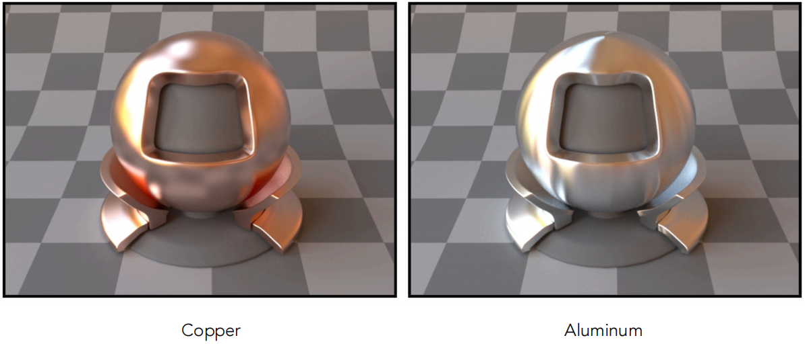

### Ideal reflective
理想反射面就是光线严格按照镜面反射的规律，不发生任何扩散。例如完美的水面和玻璃

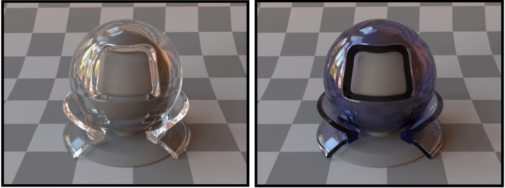

### BSDF =BTDF+BRDF
反射定律：对于镜面物体，有一个入射方向，法线方向，出射方向，入射角等于出射角。

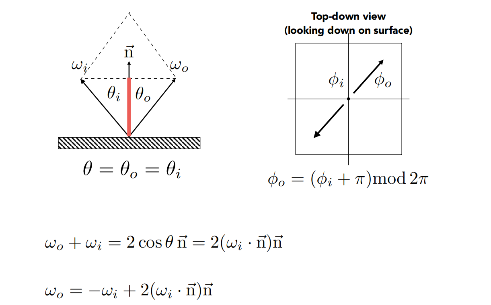

折射斯内尔定律：入射角的正弦和折射角的正弦，它们之间满足折射率相乘相等的关系。

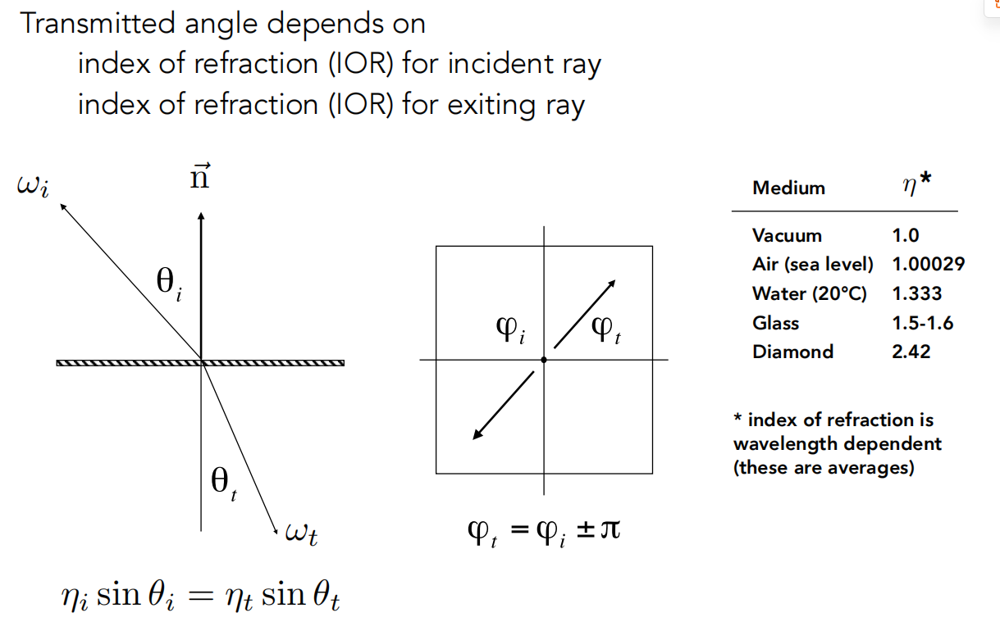

折射角的计算：

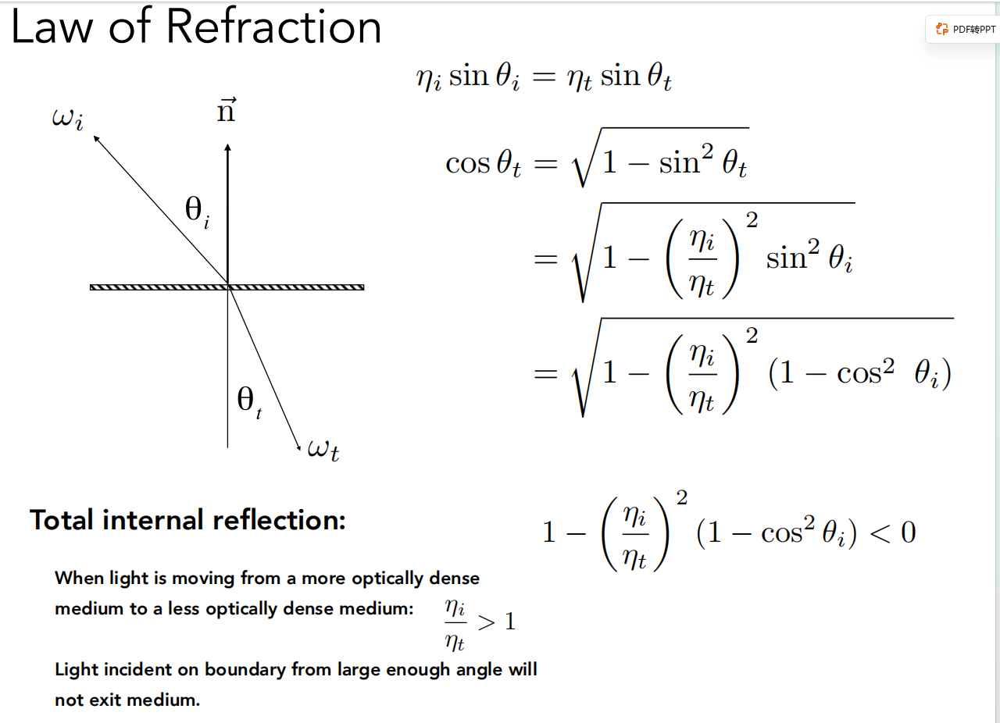

反射BRDF和折射BTDF共同称为散射BSDF。
## **Fresnel Term(菲涅尔项)**
物体的反射率与观察角度有关
绝缘体的观察角度与法线夹角越大，反射的程度就越大

> ⚠️ 待补图：wps2.jpg

 

对于导体，即使垂直观察物体，反射程度依然很高，即在任何情况下反射的程度都很高。

> ⚠️ 待补图：wps3.jpg

 

菲涅尔项的计算

> ⚠️ 待补图：wps4.jpg

 

我们通常使用下面近似的简单计算方法

> ⚠️ 待补图：wps5.jpg

 

## 微表面理论 Microfacet

当物体的表面足够光滑时，光线会产生完美的镜面反射，而现实中的物体基本不可能有这种绝对光滑的表面，这就会产生漫反射现象，我们认为是光照射在由若干微小镜面构成的不规则表面上。
对于一个物体，当我们距离其足够远时，我们观察到的物体是由许多微小部分对其表面整体的作用，这种思想就是微表面理论。
我们认为：每一个微平面是一个镜面，每一个微平面都有自己的法线
我们可以用微表面的法线分布来表示材质的粗糙程度
法线分布的集中，就是glossy材质

> ⚠️ 待补图：wps6.jpg

 

法线分布的离散，就是diffuse材质
微表面镜面反射项材质：

> ⚠️ 待补图：wps7.jpg

函数D：法线分布函数(Normal Distribution Function)，代表了所有微观角度下微小镜面法线的分布情况，粗糙表面法线分布相对均匀，光滑表面法线分布相对集中。只有微表面的法线方向与一致入射出射的半程向量一致，光线才会反射出去，D就定义了有多少微表面可以把入射光反射出去
函数G：几何函数(Geometry Function)，描述了微平面自遮挡的属性。当一个平面相对比较粗糙的时候，平面表面上的微平面有可能挡住其他的微平面从而减少表面所反射的光线。
函数F：菲涅尔方程(Fresnel Rquation)，描述了物体表面在不同入射光角度下反射光线所占的比率。 

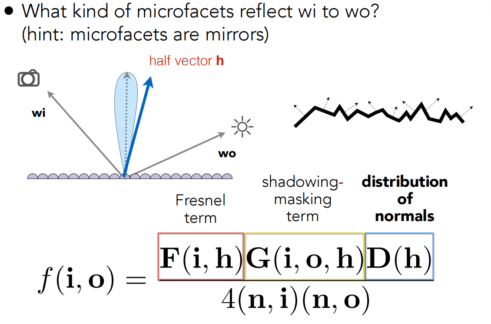

## 各项同性Isotropic/各向异性Anisotropic

各项同性：法线在各个方向的分布基本是均匀的

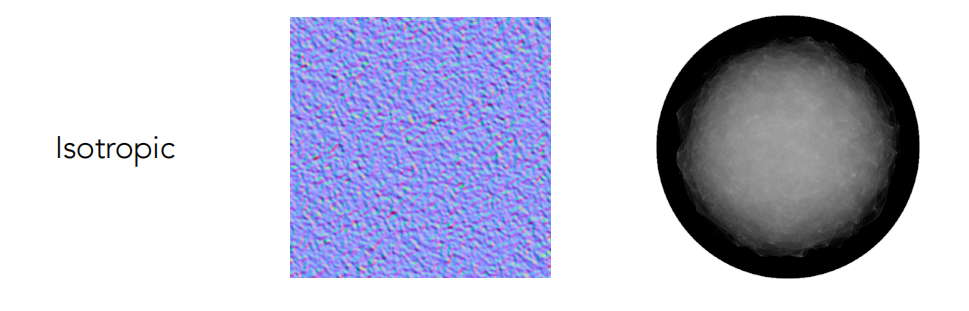

各向异性：法线分布有明显的方向性

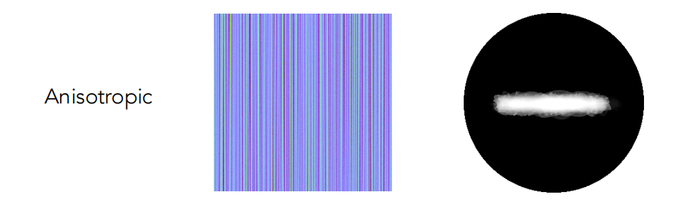

反应在BRDF上，如果在方位角上旋转入射方向和出射出射方向得到的BRDF相同，就是各项同性的，如果不满足就是各向异性的。**这样就可以来区分材质**。
## BRDF的性质
-非负性：能量是不可能是负的

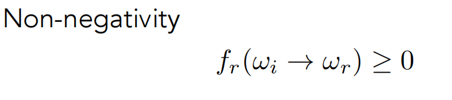

-线性性质:Bling-Phone模型中的环境光，漫反射项和高光项是线性可加的，也就是说我们可以单独计算BRDF

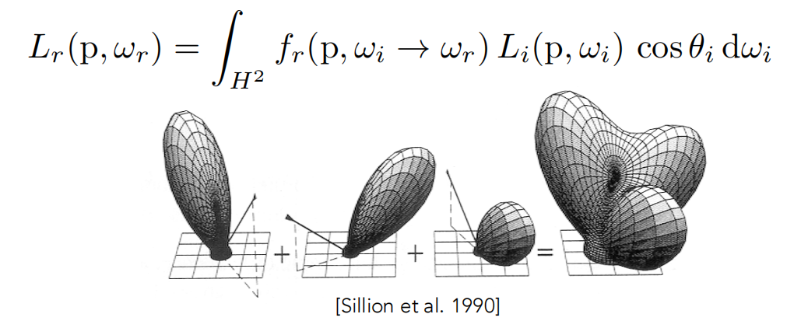

-可逆性：可以将入射光和出射光任意交换

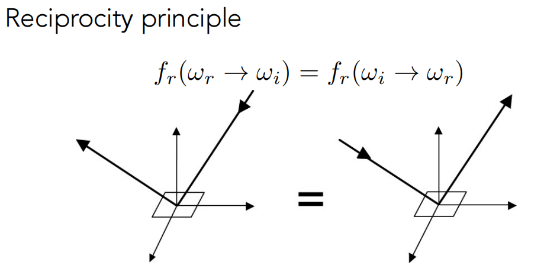

-能量守恒

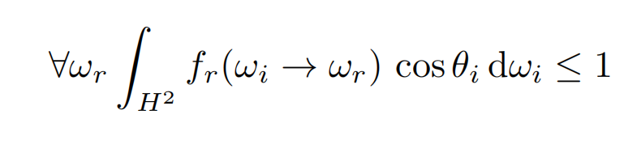

## 测量BRDF
枚举所有camera和光源的入射出射方向
